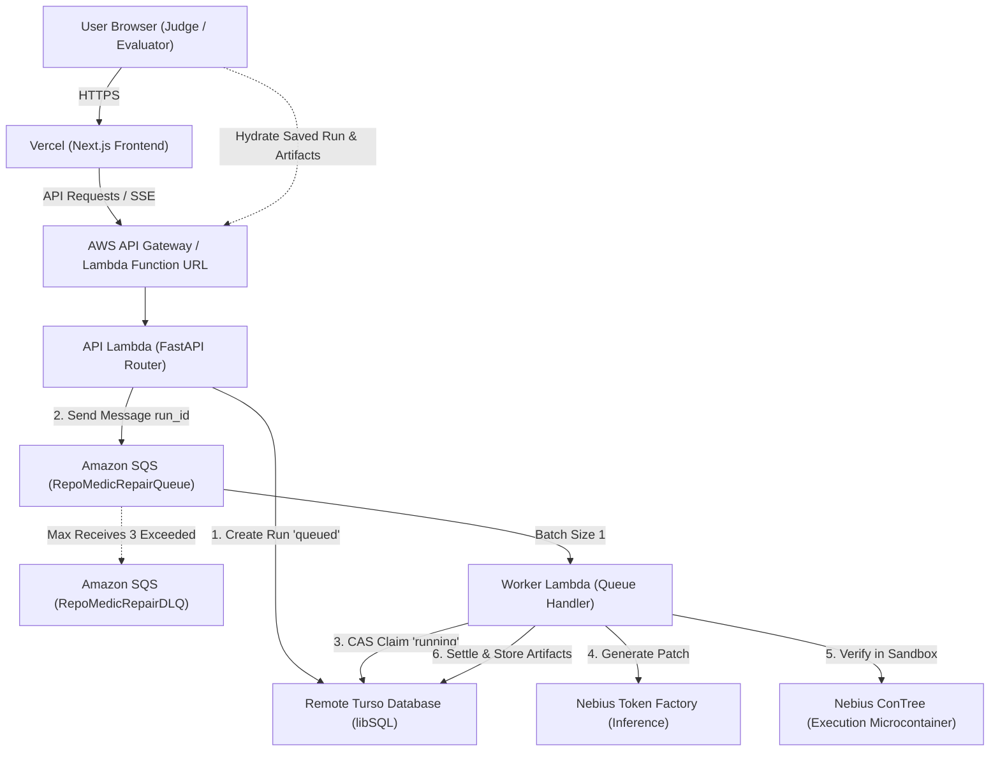

# 0008. Deploy RepoMedic on AWS SAM and Vercel

**Date**: 2026-10-27
**Status**: In Progress

## Summary

This specification defines the production submission deployment for RepoMedic. The frontend is hosted on Vercel as a Next.js application, and the backend is deployed on AWS using AWS Serverless Application Model (AWS SAM). Backend work is decoupled into an API Lambda function, an Amazon SQS message queue, and an asynchronous repair worker Lambda function. Persistence continues to use remote Turso libSQL, while live repairs run against Nebius Token Factory and ConTree sandbox providers.

## Context

RepoMedic automates dependency upgrades and self repairs breaking API changes. In local acceptance, the application runs as a single process combining the FastAPI web service and an embedded queue worker polling Turso.

While the single process model works well in standalone environments, deploying to serverless platforms introduces distinct operational constraints. On AWS Lambda, web requests terminate quickly and the compute environment freezes between calls. An embedded worker cannot reliably execute multi minute repair workflows or poll loops inside an API Lambda container.

To deliver a scalable and cost effective deployment for submission, the web layer must be separated from the background repair execution using a durable queue. The frontend must be deployed on Vercel with strict cross origin controls, and the backend infrastructure must be defined as reproducible code using AWS SAM.

## Requirements

**User stories**:
* As an evaluator or judge, I want to access the public RepoMedic web application on Vercel so that I can discover tasks, view existing repair proofs, and trigger live repairs.
* As an operator, I want backend execution managed through AWS SAM with Amazon SQS so that repair jobs run asynchronously without timeouts or lost work.
* As a maintainer, I want to preserve the existing local single process execution path so that local development and offline unit tests continue to work without AWS infrastructure.

**Acceptance criteria**:
* **AC-1**: AWS SAM template defines an API Lambda function, an SQS queue with a dead letter queue, a repair worker Lambda function, CloudWatch log groups, and least privilege IAM permissions.
* **AC-2**: Job creation stores the run record in Turso and enqueues an SQS message. Duplicate deliveries are handled via Compare And Swap state transitions, guaranteeing atomic job ownership and preventing double execution.
* **AC-3**: Embedded polling worker and startup run recovery can be disabled via environment variables in Lambda while remaining active by default for local development.
* **AC-4**: Frontend supports real time progress updates via supported AWS streaming (Lambda Function URL with response streaming) or short polling fallback against Turso event records.
* **AC-5**: Python Lambda packaging resolves native dependencies for libSQL on Amazon Linux 2023 `x86_64` and bundles task fixtures.
* **AC-6**: Vercel configuration specifies root directory `frontend`, correct API URL, and CORS restrictions limited strictly to configured frontend origins without trusting arbitrary Vercel domains.
* **AC-7**: GitHub Actions CI and CD workflow validates SAM templates, builds artifacts, runs unit tests, and deploys using short lived AWS credentials via GitHub OIDC.
* **AC-8**: Documented post deployment verification checks task loading, saved run hydration, artifact downloads, live repair execution on `TASK-091`, and independent patch reproduction.

## Options considered

### Option 1: Standalone Container on AWS App Runner or Render
Deploy the existing single process container image to AWS App Runner or Render.

**Pros**:
* Keeps the exact embedded queue worker code without changes.
* Simplifies local and production topology parity.

**Cons**:
* Continuous hourly billing ($7 to $25 monthly) even when idle.
* Requires managing container instances rather than serverless event driven execution.

### Option 2: AWS SAM with SQS and Dedicated Worker Lambda (Chosen)
Deploy FastAPI via API Gateway or Lambda Function URL, send jobs to Amazon SQS, and invoke an asynchronous repair worker Lambda function for repairs up to fifteen minutes.

**Pros**:
* True serverless scaling with zero idle cost.
* Decouples synchronous web requests from long running model and sandbox repair execution.
* SQS guarantees durable buffering and dead letter retry management.

**Cons**:
* Requires decoupling the embedded worker into an event driven SQS handler.
* Requires managing Lambda native packaging and function execution timeouts.

### Option 3: AWS Step Functions Orchestration
Orchestrate each stage (baseline, upgrade, candidate generation, verification) as individual Step Function states.

**Pros**:
* Visual execution tracking in the AWS console.

**Cons**:
* Major architectural rewrite of the sequential and branch refine engine.
* Overcomplicated for submission requirements and exceeds scope.

## Decision

**Chosen option**: Option 2: AWS SAM with SQS and Dedicated Worker Lambda, with Vercel for the Next.js frontend.

RepoMedic will deploy its frontend on Vercel and its backend on AWS using AWS SAM, decoupling web requests from repair execution through Amazon SQS while preserving the local embedded worker workflow.

## System Architecture and SAM Resources

### 1. SAM Template Resources

The template at `backend/template.yaml` specifies the following resources:

1. **`RepoMedicApiFunction`**:
   * Type: `AWS::Serverless::Function`
   * Runtime: `python3.13`
   * Architecture: `x86_64`
   * Handler: `src.lambda_api.handler`
   * Timeout: 30 seconds
   * MemorySize: 512 MB
   * Environment Variables:
     * `REPOMEDIC_ENV=production`
     * `REPOMEDIC_STORAGE_BACKEND=turso`
     * `TURSO_DATABASE_URL` (from parameter or secret)
     * `TURSO_AUTH_TOKEN` (from parameter or secret)
     * `REPOMEDIC_WORKER_ENABLED=false` (disables embedded polling loop)
     * `REPOMEDIC_STARTUP_RECOVERY_ENABLED=false` (disables recovery on Lambda boot)
     * `REPOMEDIC_APP_ORIGIN` (configured Vercel domain)
     * `REPAIR_QUEUE_URL` (Reference to SQS queue)
   * Policies:
     * SQS send message permissions on `RepoMedicRepairQueue`
   * Function URL or API Gateway HTTP API event triggering all paths `/{proxy+}`.

2. **`RepoMedicRepairQueue` and `RepoMedicRepairDLQ`**:
   * Type: `AWS::SQS::Queue`
   * MessageRetentionPeriod: 86400 (1 day)
   * VisibilityTimeout: 960 seconds (must exceed worker Lambda timeout)
   * RedrivePolicy:
     * `deadLetterTargetArn`: `!GetAtt RepoMedicRepairDLQ.Arn`
     * `maxReceiveCount`: 3

3. **`RepoMedicWorkerFunction`**:
   * Type: `AWS::Serverless::Function`
   * Runtime: `python3.13`
   * Architecture: `x86_64`
   * Handler: `src.lambda_worker.handler`
   * Timeout: 900 seconds (15 minutes maximum limit)
   * MemorySize: 1024 MB
   * Environment Variables:
     * `REPOMEDIC_ENV=production`
     * `REPOMEDIC_MODE=live`
     * `REPOMEDIC_USE_REAL_ENGINE=true`
     * `TURSO_DATABASE_URL` (from parameter or secret)
     * `TURSO_AUTH_TOKEN` (from parameter or secret)
     * `TOKEN_FACTORY_API_KEY`
     * `NEBIUS_API_KEY`
     * `NEBIUS_PROJECT_ID`
   * Events:
     * `SQSEvent`:
       * `Queue`: `!GetAtt RepoMedicRepairQueue.Arn`
       * `BatchSize`: 1 (strict single job execution per worker instance)
       * `FunctionResponseTypes`: `["ReportBatchItemFailures"]`

4. **Outputs**:
   * `ApiEndpoint`: Public HTTPS URL for the API
   * `QueueArn`: ARN of the repair queue
   * `DLQArn`: ARN of the dead letter queue

## Reliable Queuing and State Lifecycle

To eliminate lost work and duplicate execution:

1. **Atomic Creation and Enqueue**:
   * The API Lambda inserts the run record in Turso with `state = 'queued'`.
   * The API Lambda sends a message to SQS containing `{"run_id": run_id}`.
   * If SQS message delivery fails, the API Lambda marks the Turso run as `failed` with `reason = 'Failed to enqueue task to SQS'` and returns HTTP 500.

2. **Atomic Job Ownership via Compare And Swap**:
   * When `RepoMedicWorkerFunction` receives a message, it extracts `run_id`.
   * The worker executes a conditional update in Turso:
     `UPDATE runs SET state = 'running', started_at = CURRENT_TIMESTAMP WHERE run_id = :run_id AND state = 'queued'`
   * If zero rows are updated, the run was already claimed, cancelled, or finished. The worker logs an informational message and returns success to SQS to remove the duplicate message.

3. **Cancellation Handling**:
   * If a user clicks Cancel Run in the UI, `POST /api/runs/{id}/cancel` updates the run state to `cancelled` in Turso.
   * Between repair stages (baseline check, dependency bump, candidate generation, verification), the worker checks `repo.get_run_state(run_id)`.
   * If the state is `cancelled`, the worker terminates container sandboxes and exits without saving artifacts.

4. **Stale Worker and Timeout Recovery**:
   * If a worker Lambda crashes or exceeds 15 minutes, SQS redelivers the message after 960 seconds.
   * On retry, if `state == 'running'` and the elapsed time since `started_at` exceeds 15 minutes, the worker marks the run as `failed` with `reason = 'Execution timeout exceeded 15 minutes'` and discards the message.
   * Messages reaching `RepoMedicRepairDLQ` trigger CloudWatch alarms.

## Frontend Progress: Streaming and Polling Fallback

1. **Streaming Integration**:
   * When using an AWS Lambda Function URL with `RESPONSE_STREAM` invoke mode, the `/api/runs/{id}/events` route streams Server Sent Events directly to the browser.
   * Response headers include `Content-Type: text/event-stream`, `Cache-Control: no-cache`, `Connection: keep-alive`, and `X-Accel-Buffering: no`.

2. **Polling Fallback**:
   * If API Gateway HTTP API is used instead of a streaming Function URL, API Gateway buffers chunked responses.
   * The frontend client [`frontend/src/lib/api.ts`](file:///home/swyra/projects/repo-medic/frontend/src/lib/api.ts) already includes a fallback: when the stream terminates or disconnects, it issues `GET /api/runs/{id}/events?after={seq}`.
   * The backend route returns all events after cursor sequence number, and the frontend consumes them incrementally.

## Packaging and Python Dependencies

1. **Native Dependencies**:
   * The Python `libsql` package contains compiled C extensions.
   * Building via `sam build --use-container` compiles dependencies inside the official AWS Lambda Amazon Linux 2023 container image, matching architecture `x86_64`.
   * This guarantees native `.so` binaries load without `glibc` mismatch.

2. **Task Fixtures Packaging**:
   * Task definitions in `fixtures/tasks/*.json` are required by `src.fixtures`.
   * The SAM build copies `fixtures/` into the Lambda build output root so `find_task_fixture_dir()` resolves `TASK-091.json` at runtime.

## Vercel Deployment and Security Configuration

1. **Vercel Settings**:
   * Root Directory: `frontend`
   * Framework Preset: Next.js
   * Node.js Version: 22.x
   * Build Command: `npm run build`

2. **Environment Variables**:
   * `NEXT_PUBLIC_API_TRANSPORT=http`
   * `NEXT_PUBLIC_API_URL=/api` (or direct backend URL `https://[api-id].execute-api.[region].amazonaws.com/api`)
   * `BACKEND_URL=https://[api-id].execute-api.[region].amazonaws.com`
   * `NEXT_PUBLIC_DOCS_URL=https://github.com/SGOD-pro/repo-medic`

3. **Strict CORS Policy**:
   * Do not use wildcard `*.vercel.app`.
   * Configure `REPOMEDIC_APP_ORIGIN` on the backend with only the exact production frontend domains (for example `https://repo-medic.vercel.app,http://localhost:3000`).
   * The FastAPI CORS middleware will strictly validate incoming `Origin` headers against this allowlist.

## CI and CD Pipeline Specification

The GitHub Actions workflow at `.github/workflows/ci.yml` is expanded to include SAM deployment:

1. **Pull Request and Push to Branches**:
   * Run backend lint (`flake8`) and unit tests (`pytest`).
   * Run frontend lint, typecheck, unit tests, and production build.
   * Validate SAM template: `sam validate --lint`.
   * Paid live tests remain opt in and skip automatically.

2. **Main Branch Deployment to AWS**:
   * Authenticate to AWS using GitHub OIDC:
     `uses: aws-actions/configure-aws-credentials@v4` with `role-to-assume: arn:aws:iam::<account>:role/RepoMedicSAMDeployerRole`.
   * Build serverless package:
     `sam build --use-container`
   * Deploy stack:
     `sam deploy --no-confirm-changeset --no-fail-on-empty-changeset --stack-name repomedic-production --parameter-overrides TursoUrl=$TURSO_DATABASE_URL TursoToken=$TURSO_AUTH_TOKEN NebiusApiKey=$NEBIUS_API_KEY ...`

3. **Vercel Git Integration**:
   * Pushes to `main` automatically trigger production deployment on Vercel.

## Post Deployment Acceptance Procedure

Once deployed, execute the following verification steps:

1. **Public Health and Task Discovery**:
   * `curl -s https://[api-endpoint]/api/tasks | grep "TASK-091"`
   * Verify tasks return successfully with HTTP 200.
2. **Budget Usage**:
   * `curl -s https://[api-endpoint]/api/budget/usage`
   * Verify budget shows settled and reserved amounts within the $25 USD limit.
3. **Public Frontend and Demo Hydration**:
   * Open the Vercel URL in a browser. Confirm live status badge.
   * Open `https://[frontend-domain]/?runId=run_93c660238e3443a6a18249167eb1939b`.
   * Verify verification report hydrates completely from remote Turso without starting a new run.
4. **Artifact Downloads**:
   * Download `patch.diff`, `verify.log`, and `evidence.json` directly from the web interface. Confirm SHA-256 hashes match.
5. **Live Bounded Repair Execution**:
   * Trigger one repair of `TASK-091` using the Sequential strategy through the UI.
   * Verify SQS receives message and worker Lambda executes repair.
   * Confirm terminal status `succeeded` in browser.
6. **Independent Reproduction**:
   * Clone pinned commit `453a0b6c6b125177504cdd941902b8d48266ed1c`.
   * Apply downloaded patch with `git apply --recount --whitespace=nowarn`.
   * Run `pytest tests/` and confirm 1/1 tests pass.

## Failure Handling and Rollback Plan

* If SQS messages fail repeatedly, redrive sends them to `RepoMedicRepairDLQ`.
* If a deployment fails validation, SAM cancels changesets automatically.
* To roll back AWS backend: `sam deploy` to previous git commit SHA or run CloudFormation rollback.
* To roll back Vercel frontend: select previous instant deployment in the Vercel dashboard and click Promote to Production.

## Build Plan

* **Task 1 (Backend Decoupling)**: Add `REPOMEDIC_STARTUP_RECOVERY_ENABLED` flag to `backend/src/config.py` and `backend/src/main.py`. Add Lambda entrypoints `src/lambda_api.py` and `src/lambda_worker.py`. (Satisfies AC-2, AC-3)
* **Task 2 (SAM Infrastructure Template)**: Write `backend/template.yaml` defining API Gateway, SQS Queue, DLQ, Worker Function, and IAM policies. (Satisfies AC-1, AC-5)
* **Task 3 (SQS Integration in API)**: Update run creation in API Lambda to send SQS messages when `REPAIR_QUEUE_URL` is set, with CAS claiming logic in the worker. (Satisfies AC-2)
* **Task 4 (Strict CORS Policy)**: Restrict CORS middleware to exact configured domains in `REPOMEDIC_APP_ORIGIN`, removing arbitrary wildcard regex. (Satisfies AC-6)
* **Task 5 (CI/CD Deployment Workflow)**: Update `.github/workflows/ci.yml` with SAM build, validation, and OIDC deployment steps. (Satisfies AC-7)
* **Task 6 (Documentation and Verification)**: Update `docs/DEPLOYMENT.md` with SAM commands, parameters, and post deployment testing checklist. (Satisfies AC-8)
